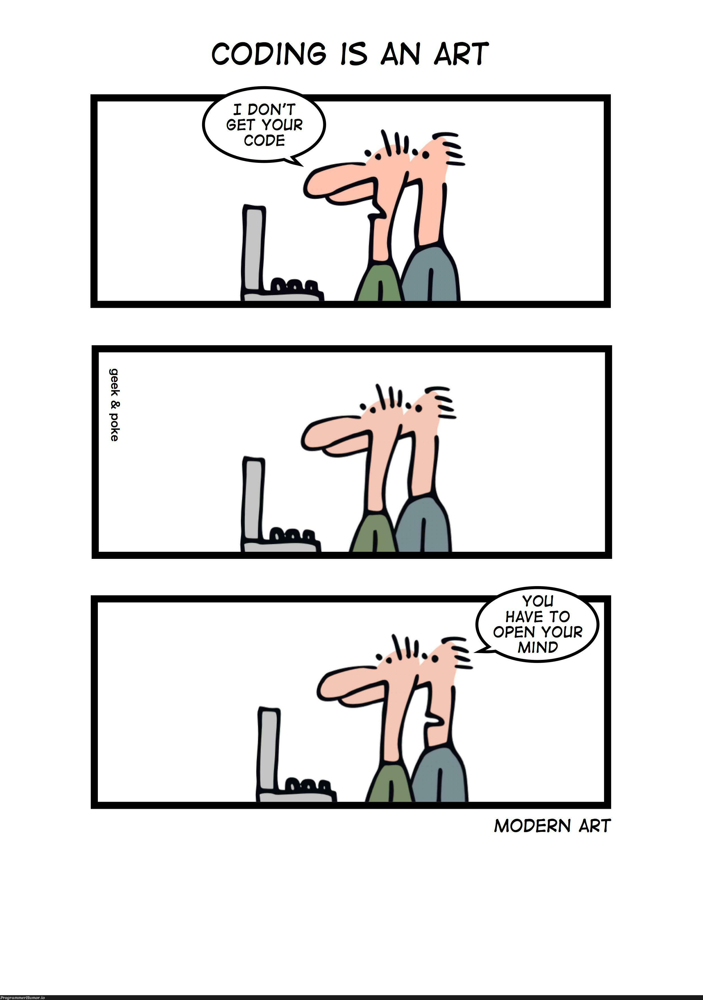

# Lint

::: {.callout-tip icon=false} 
## :dart: Learning goals of this lecture
- know what linting/code analysis is
:::


## Linter
Why does it make sense to use a Linter?

- In C/C++ the control flow is done via `{ ... }`
- The compiler does not care how it is formatted but we should, it is easier
   - to navigate the code
   - to find bugs
   - to maintain the code
   - to homogenise styles between different people
- We use such tools to have consistent code style/coding standard in the project
- It allows to check for (common) problems &rarr; clean-up before a commit
   - Static code analysis like unreachable code
   - _assigned but never used_
   - syntax errors
   - vulnerabilities
   - undefined or dangerous behaviour


## Coding is an art!? 1/2

::: {.columns}
:::: {.column width="50%"}

::::
:::: {.column width="50%"}
::::: {.column width="100%" .custom-box}
### Code file [`phase.c`](./code/phase.c)
```{.cpp include="./code/phase.c"}
```
:::::
::::
:::


## Coding is an art!? 2/2

::: {.columns}
:::: {.column width="50%"}

::::
:::: {.column width="50%"}
::::: {.column width="100%" .custom-box}
### Code file [`phase.c`](./code/phase.c)
```{.cpp include="./code/phase.c"}
```
```{python}
#| echo: false
%run ../../scripts/compile_and_run_cpp.py ./code/phase.c
```
:::::
::::
:::


## Why we need a formatter? 1/2

::::: {.column width="100%" .custom-box}
### Code file [`code_ugly.cpp`](./code/code_ugly.cpp)
```{.cpp include="./code/code_ugly.cpp"}
```
```{python}
#| echo: false
%run ../../scripts/compile_and_run_cpp.py ./code/code_ugly.cpp 
```
:::::

## Why we need a formatter? 2/2

::: {.column width="100%" .custom-box}
### Code file [`code_ugly.cpp`](./code/code_ugly.cpp)
```{.cpp include="./code/code_ugly.cpp"}
```
:::

::: {.column width="100%" .custom-box}
### Code file [`code_formatted.cpp`](./code/code_formatted.cpp)
```{.cpp include="./code/code_formatted.cpp"}
```
:::


## A formatter alone is no guarantee but helps

::: {.column width="100%" .custom-box}
### Code file [`phase_formatted.c`](./code/phase_formatted.c)
```{.cpp include="./code/phase_formatted.c"}
```
Formatted 2024 winner \emph{International Obfuscated C Code Contest}
<https://github.com/ioccc-src/winner/tree/master/2024/kurdyukov1>

:::


## Common tools for formatting
There are multiple tools available

- `clang-format`
- `ms-vscode.cpptools` (comes with the plugin)

## :writing_hand: In class Exercise

::: {.column width="100%" .custom-box}
### Include a formatter in your setup

Activate a formatter in VScode to _automatically_ format the code (usually you can use `CTRL`+`SHIFT`+`I`) and you can activate _format on save_.
:::

## Why a code analysis is beneficial? 1/4

What is wrong with the following code snippet?

::: {.column width="100%" .custom-box}
### Code file [`array.cpp`](./code/array.cpp)
```{.cpp include="./code/array.cpp"}
```
:::

## Why a code analysis is beneficial? 2/4

What is wrong with the following code snippet?

::: {.column width="100%" .custom-box}
### Code file [`array.cpp`](./code/array.cpp)
```{.cpp include="./code/array.cpp"}
```
:::

```{python}
#| echo: false
#| results: asis
print("$ cppcheck --enable=all code/array.cpp")
%sx cppcheck --enable=all code/array.cpp
```

## Why a code analysis is beneficial? 3/4

What is wrong with the following code snippet?

::: {.column width="100%" .custom-box}
### Code file [`array.cpp`](./code/array.cpp)
```{.cpp include="./code/array.cpp"}
```
:::

```{python}
#| echo: false
#| results: asis
print("$ clang-tidy code/array.cpp -checks=modernize-* -- -std=c++17")
%sx clang-tidy code/array.cpp -checks=modernize-* -- -std=c++17 
```


## Why a code analysis is beneficial? 4/4

What is wrong with the following code snippet?

::: {.column width="100%" .custom-box}
### Code file [`array.cpp`](./code/array.cpp)
```{.cpp include="./code/array.cpp"}
```
:::

```{python}
#| echo: false
#| results: asis
print("$ clang-tidy code/array.cpp -checks=readability-* -- -std=c++17")
%sx clang-tidy code/array.cpp -checks=readability-* -- -std=c++17
```

## :writing_hand: In class Exercise

::: {.column width="100%" .custom-box}
### Include a formatter in your setup

Install `cppcheck` and `clang-tidy` and test them for yourself on some of our code snippets. Try different options.
:::

```bash
# We need to install it in our linux environment
sudo dnf install cppcheck clang-tidy
```

## Why should we care for scientific code?

::: {.column width="100%" .custom-box}
### For _scientific code_ we often get:

**Why should we care, this is not for production and only we use it!**
:::

What are your thoughts on the following statements?

- A `Segmentation fault` will indicates a problem in the mathematics, not the code.
- Correct code is usually faster.
- Sharing the code is good scientific practice.
- I use code, I can not read/understand for my research.
