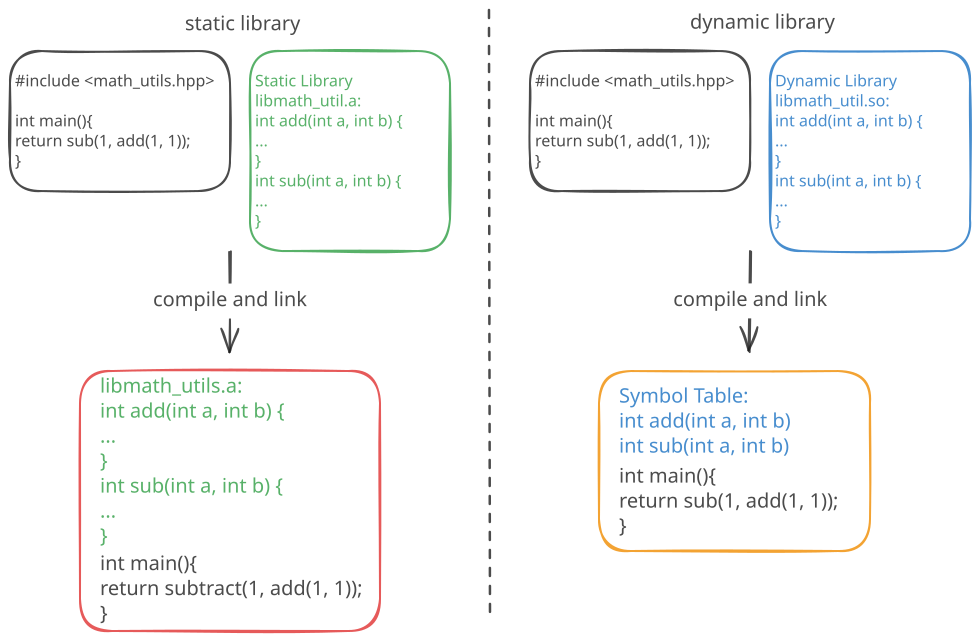
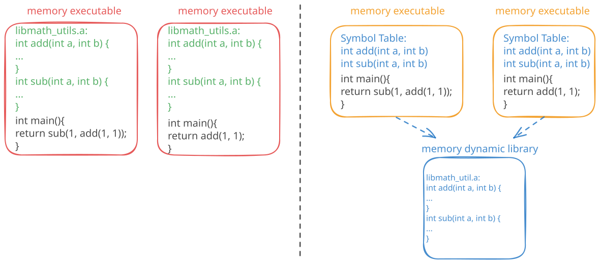

# Libraries

::: {.callout-tip icon=false} 
## :dart: Learning goals of this lecture
- Understand the different types of libraries
:::

## Libraries

Similar to other programming languages in C++ we do not write everything ourself.
Therefore, libraries are _linked_ during the build.

- **Static library**: contains code that is linked to our program at _compile time_. 
    The code is _copied_ into our executable.
- **Dynamic/shared library**: contains code shared by multiple programs.
    The code is loaded _at runtime_ and shared over multiple executables. 


{.lightbox}

## Libraries

Similar to other programming languages in C++ we do not write everything ourself.
Therefore, libraries are _linked_ during the build.

- **Static library**: contains code that is linked to our program at _compile time_. 
    The code is _copied_ into our executable.
- **Dynamic/shared library**: contains code shared by multiple programs.
    The code is loaded _at runtime_ and shared over multiple executables. 


{.lightbox}


## Pros and cons 1/2

::: {.smaller}
| **Feature** | **Static Libraries** | **Dynamic Libraries** |
|---|----|----|
| **Linking** | At compile time | At runtime |
| **Executable Size** | Larger (library code is included) | Smaller (only references to the library) |
| **Code Sharing** | No | Yes (shared across multiple programs) |
| **Runtime Dependency** | None (self-contained executable) | Requires the library to be present at runtime |
| **Performance** | Faster (no runtime loading) | Slightly slower (runtime loading overhead) |
:::

## Pros and cons 2/2

::: {.smaller}
| **Feature** | **Static Libraries** | **Dynamic Libraries** |
|---|----|----|
| **Updates** | Requires recompilation of the executable | Can update the library without recompiling |
| **Deployment** | Easier (single executable) | More complex (library must be distributed) |
| **Memory Usage** | Higher (duplicate copies in memory) | Lower (shared library in memory) |
| **Debugging** | Easier (all code is in the executable) | Harder (external dependencies to track) |
| **Security** | Safer (no external library tampering) | Risk of library hijacking or tampering |
:::

## Example

We use the example from before with the `math_utils` and in addition we have a main file. 
If we compile everything into one file the call looks like this:

::: {.column width="100%" .custom-box}
### Code file [`main.cpp`](./code/main.cpp)
```{.cpp include="./code/main.cpp"}
```
```{python}
#| echo: false
print("$ g++ ./code/main.cpp ./code/math_utils.cpp -I./code")
%run ../../scripts/compile_and_run_cpp.py ./code/main.cpp ./code/math_utils.cpp -I./code
```
:::

## Compiling

:::: {.columns}

::: {.column width="50%"}
Static library

```bash
# compile the library to an object file
$ g++ -c math_utils.cpp -o math_utils.o
# bundle object into static library
$ ar rcs libmath_utils.a math_utils.o
# Compile
$ g++ -I. -c main.cpp -o main.o
$ g++ -L. main.o libmath_utils.a -o main
# alternative
$ g++ main.o -L. -lmath_utils -o main.out
# run th executable
./main.out
```
:::
::: {.column width="50%"}
Dynamic library

```bash
# compile the library to an object file
$ g++ -c math_utils.cpp -o math_utils.o
# bundle object(s) into shared library
$ g++ -shared -o libmath_utils.so math_utils.o
# Compile
$ g++ -I. -c main.cpp -o main.o
$ g++ -L. main.o libmath_utils.so -o main.out
# alternative
$ g++ main.o -L. -lmath_utils -o main.out
# Specify location of shared library
$ export LD_LIBRARY_PATH=$LD_LIBRARY_PATH:./
# run the executable
$ ./main.out
```
:::
::::
