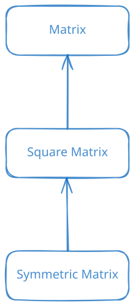

# Object Oriented Programming


::: {.callout-tip icon=false} 
## :dart: Learning goals of this course
- What is OOP?
- How does it translate to C++?
- What is _operator_ overloading?
:::

## Programming paradigms 1/2
A programming paradigm can help translate a specific problem into code.

::: {.column width="100%" .custom-box}
### Imperative programming
The code directly determines/controls the flow of the execution and explicit statement changes the state of the program.

- **structured programming**: when we use constructs like `if` and `for`
- **procedural programming**: when we with procedures/functions that call each other
- **modular programming**: when we combine logical structures into modules and include this into our program
- **object oriented programming**: when we organise our code with objects that contain data structures and associated behaviour
:::

## Programming paradigms 1/2
A programming paradigm can help translate a specific problem into code.

::: {.column width="100%" .custom-box}
### Declarative programming
The code declares the desired result but not how to compute it. 
It describes what computation should be performed without specifying detailed state changes.

- **functional programming**: where the concept of mathematical functions is used to declare the desired result as a series of function evaluations and it avoids state and mutable data
:::


## Object Oriented Programming
We organise our code with objects that contain data structures and associated behaviour. 
The main building block is a `class`, which contains:

- constructors that take care of initialization of the data structure
- destructors that take care of deletion of the data structure
- (copy) operations
- functions
- hierarchies
- protection of variables and functions
- $\ldots$

## Object Oriented Programming - C++

::: {.column width="100%" .custom-box}
### Basic structure [`class_template.cpp`](./code/class_template.cpp)
```{.cpp include="./code/class_template.cpp"}
```
:::

- **private**: Members can only be access or viewed from inside of the class.
- **protected**: Members can only be access from within inherited classes.
- **public**: Members can be access from outside the class.

## Object Oriented Programming - C++ - Header

::: {.column width="100%" .custom-box}
### Basic structure [`matrix.hpp`](./code/matrix.hpp)
```{.cpp include="./code/matrix.hpp"}
```
:::

## Object Oriented Programming - C++ - Class code

::: {.column width="100%" .custom-box}
### Basic structure [`matrix.cpp`](./code/matrix.cpp)
:::: {.code-height-500}
```{.cpp include="./code/matrix.cpp"}
```
::::
:::

## :repeat: Object Oriented Programming - C++ - Constructor/Destructor
- **Constructor**: Is called during the initialization of an _object_ and handles setting up all necessary variables. **Dynamic memory allocation is performed here.**
- **Destructor**: Is called during the deletion of an object and takes care of cleaning up. **Free dynamically allocated memory.**


## Object Oriented Programming - C++ - Used in a program

::: {.column width="100%" .custom-box}
### Basic structure [`main_matrix.cpp`](./code/main_matrix.cpp)
```{.cpp include="./code/main_matrix.cpp"}
```
```{python}
#| echo: false
%run ../../scripts/compile_and_run_cpp.py ./code/main_matrix.cpp ./code/matrix.cpp -I./code -std=c++17
```
:::

## :writing_hand: Exercise

::: {.column width="100%" .custom-box}
### Extend the program

 Add the following functions to the code with appropriate signatures:

- `getRows` returning the number of rows
- `getColumns` returning the number of columns
- `isValidIndex` as a private function and replace the checks in the current code with it
- `isSquare` return a boolean and check dimensions
- `trace` returning the trace
            $$
            \operatorname{tr}(A) = \sum_i a_{ii}
            $$
:::

## :writing_hand: Exercise - solution

::: {.column width="100%" .custom-box}
### Basic structure [`matrix2.cpp`](./code/matrix2.cpp) - partially displayed
```{.cpp include="./code/matrix2.cpp" start-line=44 end-line=61}
```
:::

## :writing_hand: Exercise - solution - in action

::: {.column width="100%" .custom-box}
### Basic structure [`main_matrix2.cpp`](./code/main_matrix2.cpp)
```{.cpp include="./code/main_matrix2.cpp"}
```
```{python}
#| echo: false
%run ../../scripts/compile_and_run_cpp.py ./code/main_matrix2.cpp ./code/matrix2.cpp -I./code -std=c++17
```
:::


## Things to keep in mind - classes

- Be careful with the _default constructor_.
- We can have multiple constructors that call each other.
- Be careful if you make elements/members of a class/object visible, especially via a pointer. What are the problems?
- Be as restrictive as possible!
- Do not neglect the destructor.
- With the keyword `static` we can define functions that belong to a class but can be called without a specific object.

## Operators and operator overloading

**operator**s are used to perform _operations_ on variables and values.

We have seen them in action already when using `+`, `*`, `<<`, $\ldots$.
Some operators are associated with a class, some are just `friends` to a class.

\lstinputlisting[language=C++, otherkeywords={Matrix, SquareMatrix}, firstline=33, firstnumber=33, lastline=38]{code/matrix2.hpp}

::: {.column width="100%" .custom-box}
### Basic structure [`matrix2.hpp`](./code/matrix2.hpp) - partially displayed
```{.cpp include="./code/matrix2.hpp" start-line=33 end-line=38}
```
:::

## Operators and operator overloading - implementation

::: {.column width="100%" .custom-box}
### Basic structure [`matrix2.cpp`](./code/matrix2.cpp) - partially displayed
```{.cpp include="./code/matrix2.cpp" start-line=63 end-line=104}
```
:::

## :writing_hand: Exercise

::: {.column width="100%" .custom-box}
### Extend the program

 Add the following operators:

- `*` as the scalar multiplication (from both sides)
- `-` we can build this from scalar multiplication an addition but is it efficient?
- `*` matrix vector multiplication

:::


## :writing_hand: Exercise - solution

::: {.column width="100%" .custom-box}
### Basic structure [`matrix2.cpp`](./code/matrix2.cpp) - partially displayed
```{.cpp include="./code/matrix2.cpp" start-line=106 end-line=130}
```
:::

## :writing_hand: Exercise - solution - in action

::: {.column width="100%" .custom-box}
### Basic structure [`main_matrix4.cpp`](./code/main_matrix4.cpp)
```{.cpp include="./code/main_matrix4.cpp"}
```
```{python}
#| echo: false
%run ../../scripts/compile_and_run_cpp.py ./code/main_matrix4.cpp ./code/matrix2.cpp -I./code -std=c++17
```
:::

## Things to keep in mind - operators

What happens in the following line of code?
  
```{.cpp}
Matrix mat3 = mat1 * 2.0;
```

. . . 


The _assignment operator_ is created by default and does a bitwise copy if not overloaded.
It does not necessarily create a new memory block and this can cause difficulties for dynamic memory. 

```{.cpp}
Matrix& operator=(const Matrix& t) 
```

The _copy constructor_ is created by default as well.
It creates a separate memory block for the new object

```{.cpp}
Matrix& Matrix(const Matrix& other) 
```

## Inheritance

When working with OOP it happens frequently that a cain of classes exist that get more specific with each link. 
To reflect this in our code we can use **inheritance** where one class _inherits_ the variables and functions of another.

{.lightbox}

## Inheritance - Header

::: {.column width="100%" .custom-box}
### Basic structure [`matrix3.hpp`](./code/matrix3.hpp)
```{.cpp include="./code/matrix3.hpp" start-line=50 end-line=55}
```
:::

## Inheritance - code

::: {.column width="100%" .custom-box}
### Basic structure [`matrix3.cpp`](./code/matrix3.cpp)
```{.cpp include="./code/matrix3.cpp" start-line=136 end-line=190}
```
:::


## Inheritance - in action

::: {.column width="100%" .custom-box}
### Basic structure [`main_matrix6.cpp`](./code/main_matrix6.cpp)
```{.cpp include="./code/main_matrix6.cpp"}
```
```{python}
#| echo: false
%run ../../scripts/compile_and_run_cpp.py ./code/main_matrix6.cpp ./code/matrix3.cpp -I./code -std=c++17
```
:::


## Inheritance - C++

What happens if we compile this?
```{.cpp}
  Matrix mat2(2, 2);
  std::cout << mat2.det() << std::endl;
``` 

. . .

```{python}
#| echo: false
%run ../../scripts/compile_and_run_cpp.py ./code/main_matrix6a.cpp ./code/matrix3.cpp -I./code -std=c++17
```

## Things to keep in mind - inheritance

- We can not access `private` parts of a matrix only `protected` or `public`
- The constructor always needs to call the _base_ as the first.
- If we use `class SquareMatrix : public Matrix` the keyword `public` is not the only choice:
    - **public inheritance**: Makes `public` members of the base class `public` in the derived class, and the `protected` members of the base class remain `protected` in the derived class.
    - **protected inheritance**: Makes the `public` and `protected` members of the base class `protected` in the derived class.
    - **private inheritance**: Makes the `public` and `protected` members of the base class `private` in the derived class.

## :writing_hand: Exercise

::: {.column width="100%" .custom-box}
### Extend the program

Add the class `TriangularMatrix` and overload the functions

- add a variable indicating if it is upper or lower triangular
- `isValidIndex`
- `setValue`
- `det`

:::

## Polymorphism 1/2

The _advantage_ of inheritance is, that we can always interprets a class as its base class. 
This allows us to write generic code.

::: {.column width="100%" .custom-box}
### Basic structure [`main_matrix7.cpp`](./code/main_matrix7.cpp)
```{.cpp include="./code/main_matrix7.cpp"}
```
```{python}
#| echo: false
%run ../../scripts/compile_and_run_cpp.py ./code/main_matrix7.cpp ./code/matrix3.cpp -I./code -std=c++17
```
:::

## Polymorphism 2/2

What happens if we want to use a function associated with `SquareMatrix`, like `det`.

. . .

::: {.column width="100%" .custom-box}
### Basic structure [`main_matrix7a.cpp`](./code/main_matrix7a.cpp)
```{.cpp include="./code/main_matrix7a.cpp"}
```
```{python}
#| echo: false
%run ../../scripts/compile_and_run_cpp.py ./code/main_matrix7a.cpp ./code/matrix3.cpp -I./code -std=c++17
```
:::

## Things to keep in mind - polymorphism

- If we want to override a function such that in the case of polymorphism we use the _correct_ version we need to use the `virtual` keyword.
- **Always** use `virtual` destructors!!!

## :writing_hand: Exercise

::: {.column width="100%" .custom-box}
### Extend the program

Make sure that `TriangularMatrix` calls the correct version of the functions and test it (e.g. by printing something).

:::
