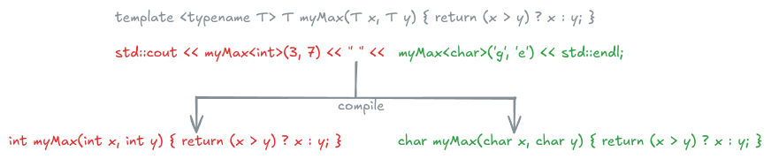

# Templates

::: {.callout-tip icon=false} 
## :dart: Learning goals of this lecture
- Templates - how to efficiently reuse you code. 
:::

## Templates

In the session about object oriented programming we created a `Matrix` class where our data was of type `double`.
What happens if we want to implement the same class with values in `float` and `complex`?

- We need to create the same class and methods again, just change the data type
- A lot of copy past code.
- Hard to maintain as we have duplicates in multiple locations.
- We have already used templates with the `std::vector` class but did not talk about it.

Our first example: We want to get the _maximum_ of elements of different types like `int`, `double`, `char`, what is the code for that?


## Templates - C++ - a first example

Can we compile the following code what will be the output?

::: {.column width="100%" .custom-box}
### Code file [`template_easy_start.cpp`](./code/template_easy_start.cpp)
```{.cpp include="./code/template_easy_start.cpp"}
```
:::

## Templates - C++ - a first example

Can we compile the following code what will be the output?

::: {.column width="100%" .custom-box}
### Code file [`template_easy_start.cpp`](./code/template_easy_start.cpp)
```{.cpp include="./code/template_easy_start.cpp"}
```
```{python}
#| echo: false
%run ../../scripts/compile_and_run_cpp.py ./code/template_easy_start.cpp
```
:::

## Templates - C++ - how is this done?

During the compilation the code is analysed and the necessary functions are created by the compiler:

{.lightbox}


## Templates - C++ - argument detection since C++17

Since C++17 we can even skip specifying the type and it is detected automatically. 

::: {.column width="100%" .custom-box}
### Code file [`template_easy_autodetect.cpp`](./code/template_easy_autodetect.cpp)
```{.cpp include="./code/template_easy_autodetect.cpp"}
```
```{python}
#| echo: false
%run ../../scripts/compile_and_run_cpp.py ./code/template_easy_autodetect.cpp
```
:::

## Templates - C++ - Where can we apply this technique?

We can crate `templates` for

- functions
- classes
- variables (since c++14)

and we can use multiple types if needed:

```{.cpp}
template <typename T1, typename T2, typename T3> class Test
{
  public:
    T1 x;
    T2 y;
    T3 z;
}
```

## Templates - C++ - variable template since C++14

::: {.column width="100%" .custom-box}
### Code file [`template_variable.cpp`](./code/template_variable.cpp)
```{.cpp include="./code/template_variable.cpp"}
```
```{python}
#| echo: false
%run ../../scripts/compile_and_run_cpp.py ./code/template_variable.cpp
```
:::

## Templates - C++ - Good to know

There are a couple of additional things for templates that are good to know

- We can specify default templates

   ```{.cpp}
   template <typename T1, typename T2=double, typename T3=string> class Test
   ```
- We can mix template and _normal_ arguments in a signature

   ```{.cpp}
   template <class T, int max> int arrMin(T arr[], int n)
   ```
- What happens if we try to compile the following fragment?

    ```{.cpp}
    std::cout << "Max of 7 and 3.0 is: " << myMax(7, 3.0) << std::endl;
    ```

## :writing_hand: Exercise

::: {.column width="100%" .custom-box}
### Write your own program

Rewrite the class `Matrix` and the according functions and test with `float`, `int`.

- What about the operators we defined?
- Can you also find a complex type we can use?
:::

## Templates - C++ - metaprogramming

It is possible to do metaprogramming with templates and therefore use templates to compute something during compile time.
It heavily depends on recursion

::: {.column width="100%" .custom-box}
### Code file [`template_meta.cpp`](./code/template_meta.cpp)
```{.cpp include="./code/template_meta.cpp"}
```
```{python}
#| echo: false
%run ../../scripts/compile_and_run_cpp.py ./code/template_meta.cpp
```
:::